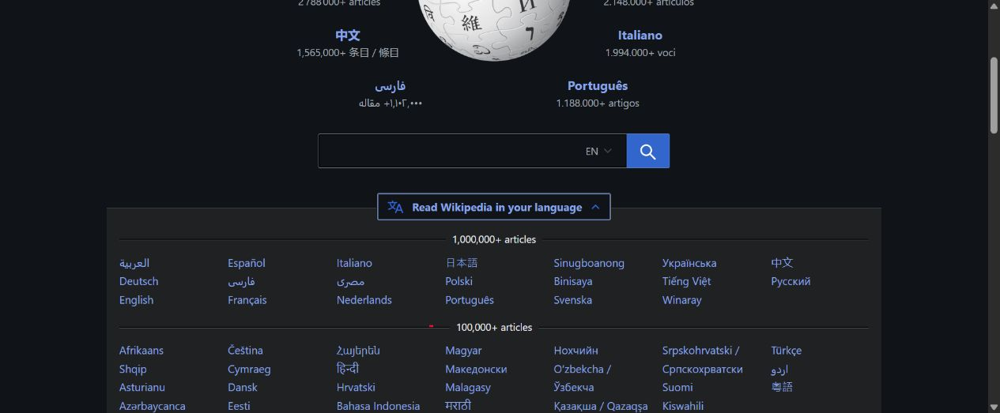

# Usability evaluation: Wikipedia language portal

Date: 15 November 2026. Target: [Wikipedia portal](https://www.wikipedia.org/). Method: single evaluator heuristic inspection of the live page, using its visible UI and accessibility tree in Chrome desktop. The initial screenshot viewport is approximately 1265 × 523 CSS pixels. No participant sessions or timing measurements were performed.

## Context and tasks

Assumed audience: novice multilingual readers, including a reader looking for Urdu. This is a scenario, not a researched persona.

- T1: Identify which language an article search will use.
- T2: Find Urdu when it is absent from the featured language links.
- T3: Browse the complete set of languages without already knowing an edition's size.

Severity scale: 0 = no issue; 1 = cosmetic; 2 = minor friction with a workaround; 3 = major task obstruction; 4 = task impossible. Ratings below are provisional evaluator judgments.

## Findings

| ID | Reproduction and observed evidence | Potential effect and heuristic | Severity | Recommendation |
| --- | --- | --- | --- | --- |
| U1 | Open the portal and inspect the language control within the search field. Its visible compact label was EN; the accessibility tree exposed English. See home screenshot. | A novice may overlook the search scope or need to decode the abbreviation. Recognition rather than recall. This is a visual discoverability concern, not a claim that the control lacks an accessible name. | 2 | Show a separate Search language label and full language name. |
| U2 | Expand Read Wikipedia in your language. The directory is divided into article-count bands, including 1,000,000+ and 100,000+. Urdu appeared in the latter. The expanded directory showed language links, with no separate language-filter field observed. | A reader who knows a language name but not edition size may scan several groups. Match between system organization and the reader's goal. Browser Find and the existing search-language dropdown remain workarounds. | 2 | Add filtering by native/English language name and an A-Z view. |
| U3 | On initial load, Urdu was absent from the ten featured language links. It was available through the search-language dropdown or expanded directory. At the captured viewport height, the directory toggle was below the visible search field. | Featured languages get a more direct route; a reader seeking another language may need more discovery or scrolling. Flexibility and efficiency of use. | 2 | Place an All languages action next to the search task. Do not remove access to smaller editions. |

The observed facts support hypotheses about friction; they do not prove users fail these tasks. U2 and U3 concern related but distinct steps: locating the directory and finding a language within it. Avoid double-counting them as independent measured failures.

## Evidence




The expanded capture may show only the upper directory portion because it is a viewport screenshot. The inspection transcript below records the relevant lower entry without implying it is visible in that crop.

```text
Initial: search text field Search Wikipedia
Initial: language control EN, selected value English
Initial: Read Wikipedia in your language (collapsed)
After expansion: Read Wikipedia in your language (expanded)
Directory: heading 1,000,000+ articles
Directory: heading 100,000+ articles
Directory: Urdu native-name link اردو, help text Urdu, destination ur.wikipedia.org/
```

## Redesign traceability and limits

[Wireframe board](wireframes/wikipedia-redesign.svg): screen 01 addresses U1 with a full search-language name and U3 with a visible All languages button. Screen 02 addresses U2 with a proposed filter and alphabetic list. Urdu is an illustrative shortcut for this scenario, not a recommendation to prioritize one language globally.

The portal already provides a named search field, accessible language selection, multiple paths to editions, and descriptive project links. Preserve these strengths. No claim is made about WCAG compliance, mobile behavior, article quality, real search errors, or participant success rates. See the [test plan](test-plan.md) for the next evaluation cycle.

Source: live [Wikipedia portal](https://www.wikipedia.org/), accessed 15 November 2026. Screenshots document the inspected state; the site and featured languages may change.
